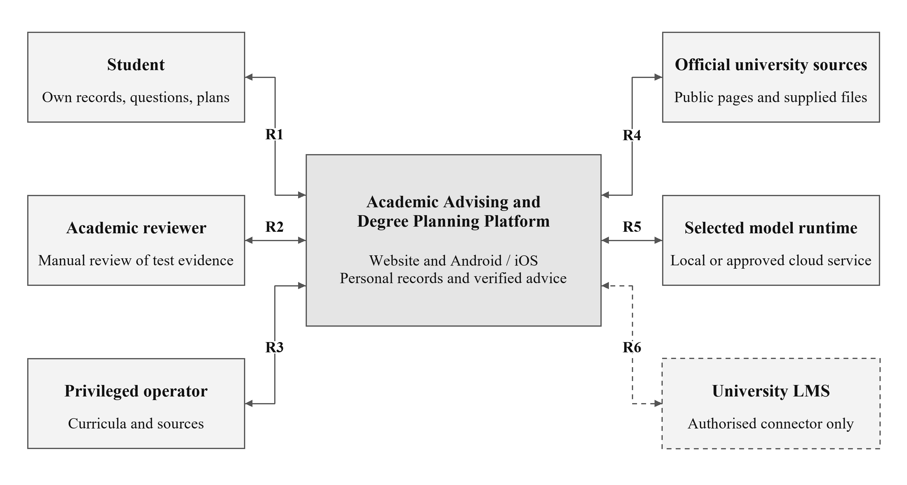
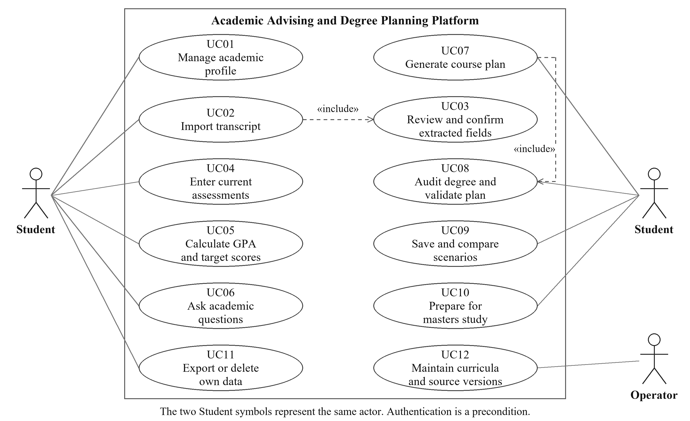
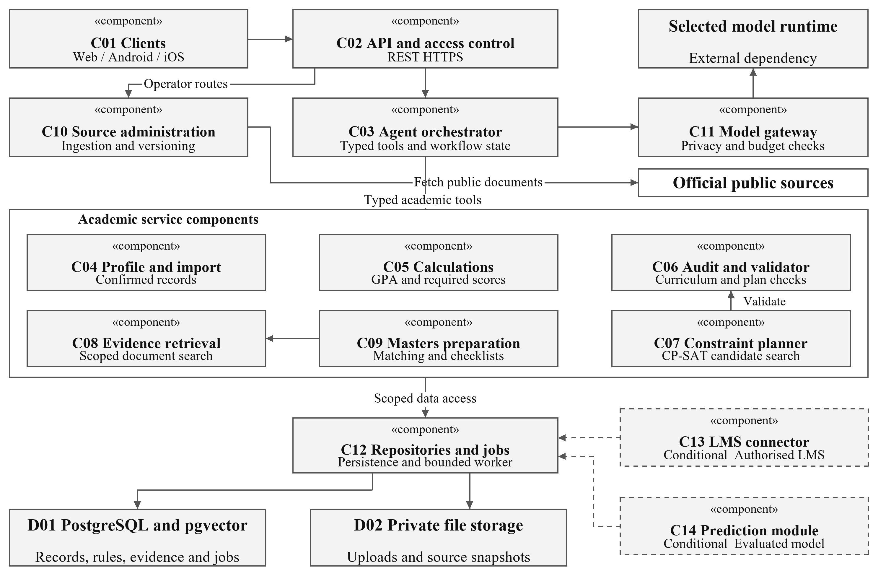

# 7 Architecture and Diagrams

## 7.1 Architectural baseline

A modular backend serves all clients. Access control precedes owned-data operations. Typed services separate record import, calculations, auditing, independent validation, bounded planning, retrieval and master’s preparation. The model receives only permitted, scoped context through a gateway. PostgreSQL stores versioned records and durable job states; protected file storage retains uploads and snapshots. Logical components initially share one deployment [42] [43] [44].

## 7.2 System context diagram

Figure 1: System context and external relationships

R1 student records/questions/results; R2 manual academic review; R3 operator source maintenance; R4 official sources; R5 selected model runtime; R6 conditional authorised LMS connection. These relationship labels are local to the figure and differ from the evidence themes R1–R7.

## 7.3 Use Case Diagram

Figure 2: Mandatory student and operator goals

## 7.4 Component Diagram

Figure 3: Logical components and selected dependencies

## 7.5 Responsibilities data and scenario alignment

Table 19: Component responsibilities and requirements

| Components | Responsibility and principal requirements |
| --- | --- |
| C01 Clients; C02 API/access | Web/Android/iOS structured screens and chat; authenticate, enforce ownership and validate requests. FR01/FR20; NFR02/NFR06. |
| C03 Orchestrator; C11 model gateway | Select permitted tools, retain workflow state, control private-data routing, provider/output budgets and model identifiers. FR13; NFR08/NFR09/NFR12. |
| C04 Profile/import | Parse into editable staging; confirm fields; store profile revisions and manual assessment data. FR02–FR04; NFR10. |
| C05 Calculations | Exact GPA, scenarios and required-score feasibility using configured repeat/rounding rules. FR05/FR06; NFR01. |
| C06 Audit/validator; C07 planner | C06 checks programme requirements and candidate constraints; C07 performs bounded search and invokes C06. FR09–FR12; NFR04/NFR07. |
| C08 Retrieval; C09 master’s | Applicable evidence, official programme discovery, status matching and saved sourced checklists. FR07/FR08, FR17–FR19; NFR03. |
| C10 Source administration | Operator-only source/curriculum versioning; fetch official public pages; distinguish real/mock inventories. FR14–FR16; NFR07. |
| C12 Repositories/jobs | Scoped persistence, transactions, revisions, idempotent jobs, export/deletion and recovery. FR02/FR12/FR20; NFR04/NFR08/NFR11. |
| C13 LMS; C14 prediction | Conditional FR21/FR22 only; no access or trained predictor is assumed. |

UC01 manages profiles; UC02/UC03 import and confirm; UC04 enters assessments; UC05 calculates targets; UC06 asks sourced questions; UC07 generates and includes UC08 audit/validation; UC09 saves alternatives; UC10 prepares for master’s study; UC11 exports/deletes; UC12 maintains sources. FR13 coordinates these goals rather than introducing a separate actor. Authentication is a precondition for personal workflows.

Table 20: Core workflows data and acceptance alignment

| Scenario and data | Component interaction and required outcome |
| --- | --- |
| Import — owned profile; protected transcript file | C02 → C04 staging → student correction/confirmation → C12 revision. Unsupported files fail visibly; unconfirmed values cannot affect GPA. AT03/NT10. |
| Target GPA — profile/rule revision and result | C03 retrieves via C04 → C05 calculates → C12 records → C03 explains exact values. Synthetic reference: 2.33 current; 4.33 required; 2.89 maximum. AT05/AT13/NT01. |
| Course plan — curriculum and scenario revisions | C06 audits → C07 bounded search → C06 validates → C12 saves independent alternative. Empty terms and UNKNOWN remain visible; optimum requires proof. AT09–AT13. |
| Master’s — official source and checklist | C09 uses C10/C08 evidence → compares confirmed qualifications → C12 saves status/checklist. Refresh changes evidence, not qualifications. AT17–AT19/NT03. |

Each result retains operation ID, profile/curriculum/source versions and outcome. Updating a profile or rule marks affected saved results for revalidation. Deletion invalidates owned records, files and jobs; restoration reapplies the deletion ledger. Retrieved text is untrusted data and cannot authorise tools or disclosure. The model cannot execute arbitrary SQL or activate extracted fields.

## 7.6 Interfaces and execution lifecycle

REST/HTTPS contracts expose profiles, imports, calculations, audits, plans and checklists. POST /v1/transcripts creates a staging job; POST /v1/transcripts/{id}/confirm activates reviewed data; POST /v1/plans starts bounded planning; GET /v1/jobs/{id} returns queued, running, succeeded, failed or cancelled. Solver and validation statuses are separate fields. Requests carry the applicable profile/configuration revision; the server resolves ownership.

C12 commits a durable job before returning its ID. Workers claim jobs transactionally, prevent duplicate side effects, verify revisions before publishing and stop at the configured deadline. Restart recovers or safely fails interrupted work. Clients poll, with optional streaming; network loss does not silently duplicate imports or paid calls. Frontend frameworks, exact model, hosting and iOS build resources remain implementation decisions to confirm.

Numerical citations refer to [References](references.md).
