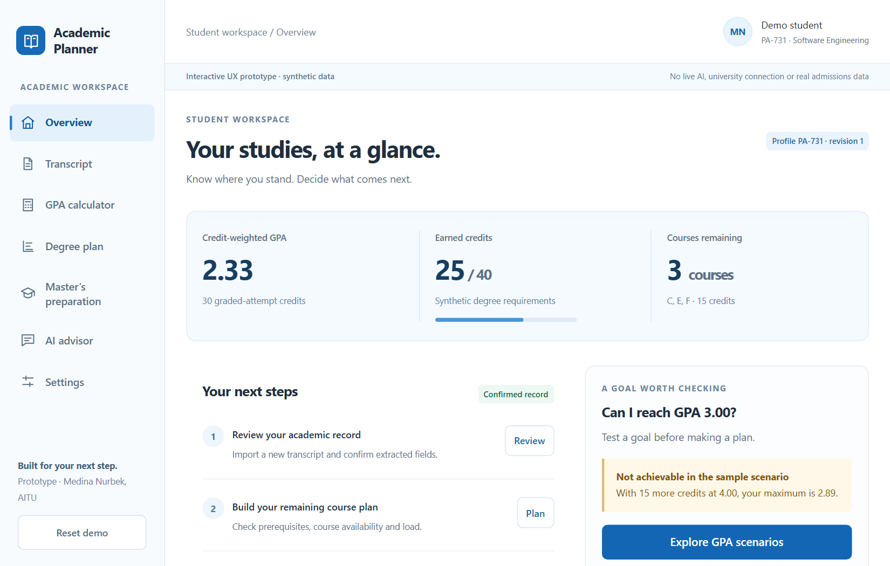
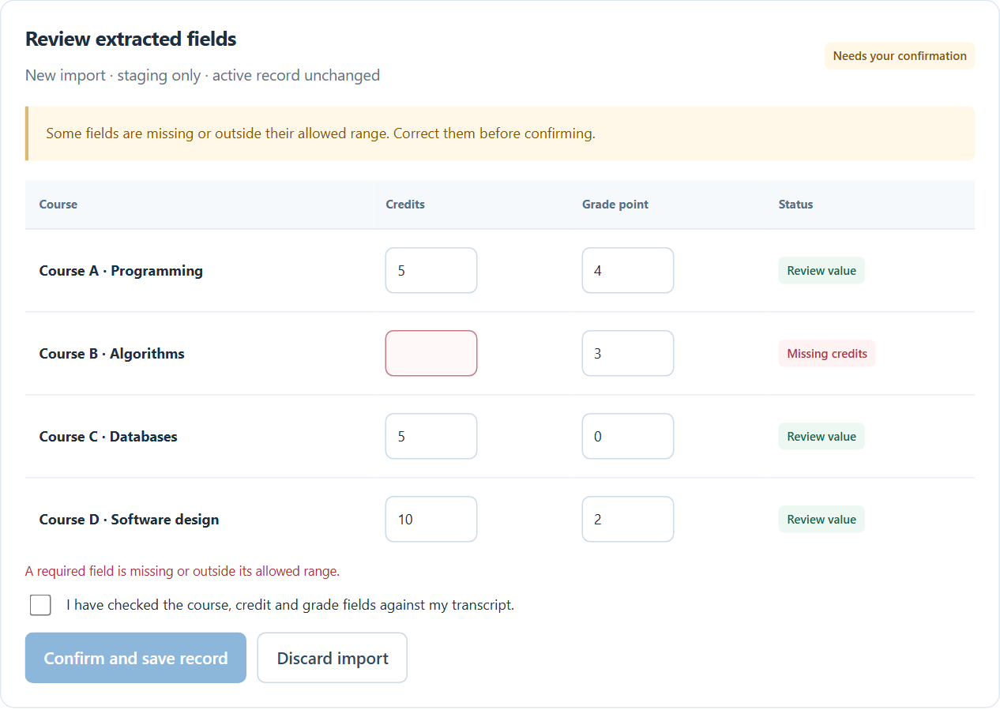
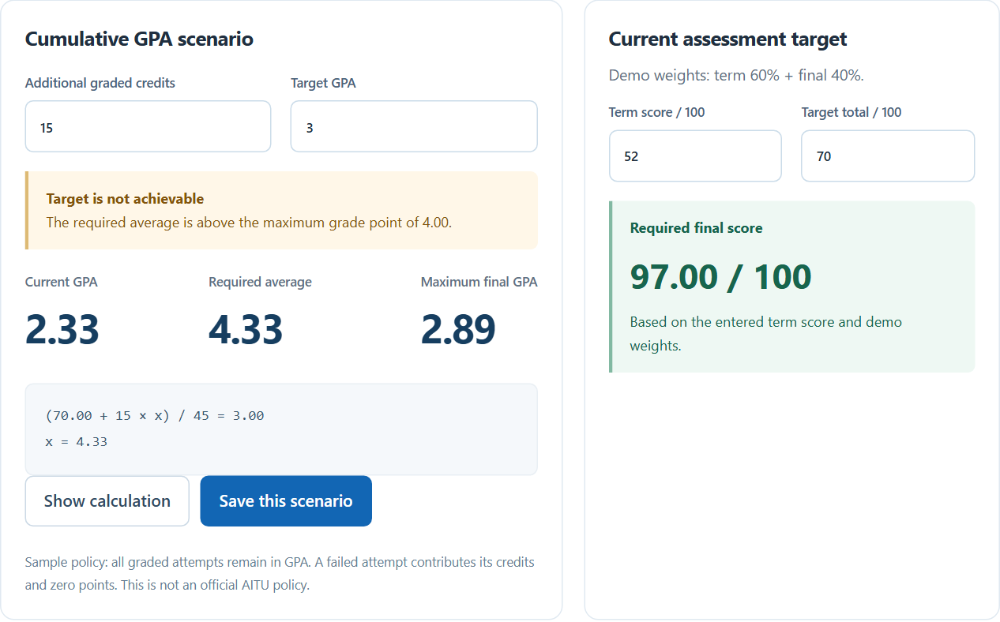
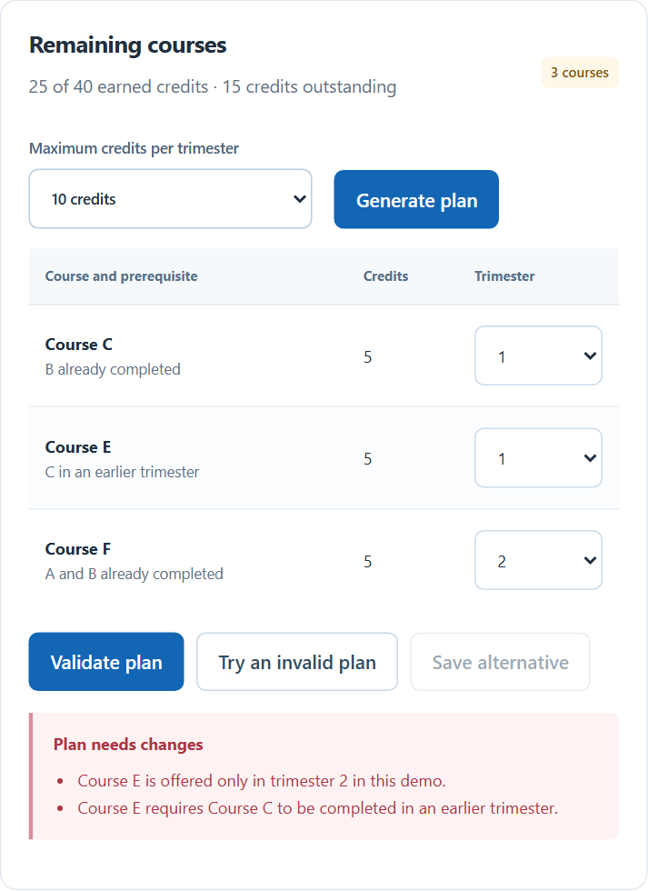
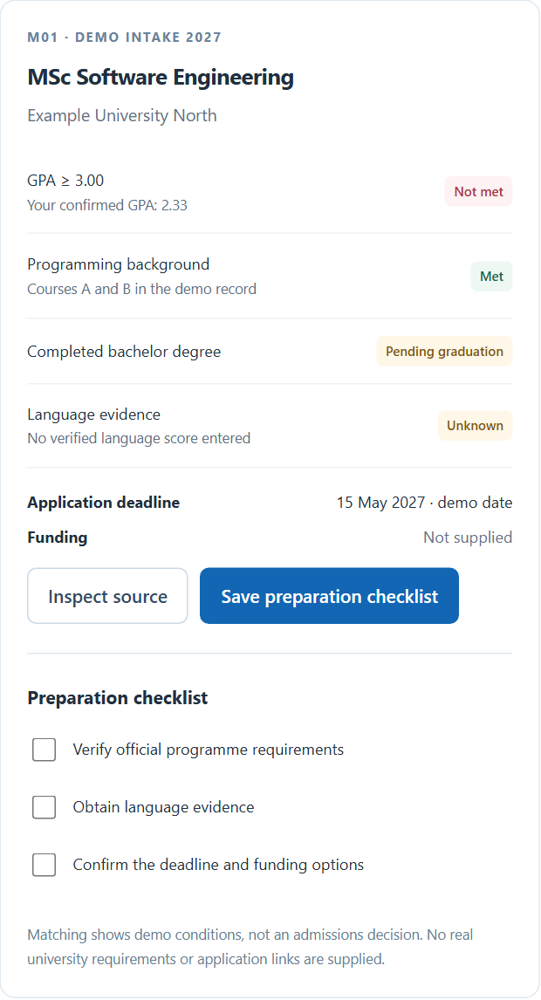
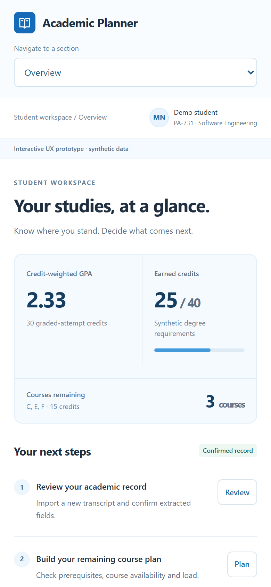

# 8 UX and Prototype

## 8.1 Prototype boundary and user journey

The white-and-blue HTML prototype uses synthetic data for record review, calculations, plan correction and master’s preparation. Browser storage retains demo changes; Reset demo restores the fixture. Real parsing, authentication, live AI, university integration and native applications remain unimplemented. Tool traces are scripted.

## 8.2 Student overview

Figure 4: Student overview

The overview distinguishes 30 GPA attempt credits from 25 earned degree credits and offers the next academic action.

## 8.3 Transcript review

Figure 5: Transcript review

Missing Course B credits block confirmation. Correcting the field and confirming creates a new revision; discarding leaves the active record unchanged. A chosen real file is not read or uploaded.

## 8.4 Calculations and targets

Figure 6: Calculations and targets

The target example shows current GPA 2.33, required average 4.33 and maximum 2.89. The separate 60/40 assessment fixture needs 97/100 for total 70 with term score 52. Missing values remain missing.

## 8.5 Plan validation

Figure 7: Plan validation

The invalid plan identifies prerequisite and offering violations. Saving is blocked until validation passes. The fixed demonstration supports separate alternatives and marks them stale after a source change.

## 8.6 Master’s comparison and checklist

Figure 8: Master’s comparison and checklist

Fictional programmes distinguish met, unmet, conditional (displayed as pending graduation) and unknown conditions. Sources disclose demonstration data. Saving a checklist does not establish eligibility or admission.

## 8.7 Mobile interaction

Figure 9: Mobile interaction

Responsive browser navigation stacks content at a 390-pixel viewport. Native Android/iOS builds, file pickers and cross-client persistence remain to be implemented.

## 8.8 Executed checks and implementation handoff

Nine Chromium checks passed on 20 October 2026: overview, confirmation, targets, plan validation, checklist, scripted advisor, source revisions, export/deletion and responsiveness. No JavaScript error or external HTTP request was observed. These PX checks do not verify production AT/NT requirements or student usability. Remaining work covers authentication/operator authorisation, actual parsing, complete assessment editing, loading/cancellation/timeout and source-conflict states, Russian review and native-client testing.

Numerical citations refer to [References](references.md).
